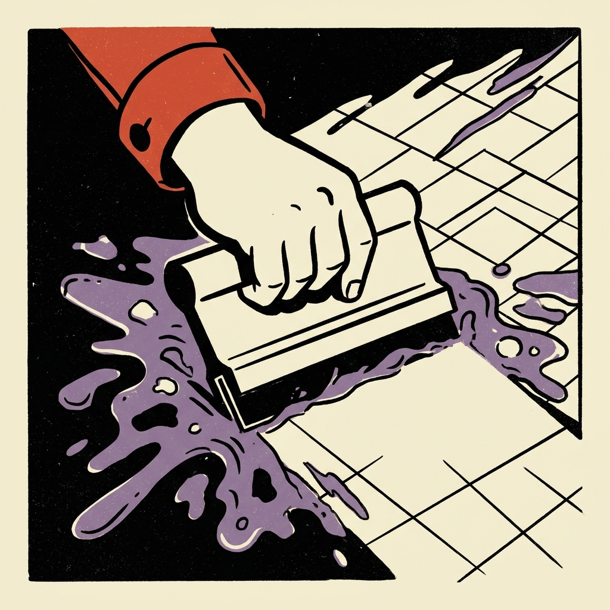
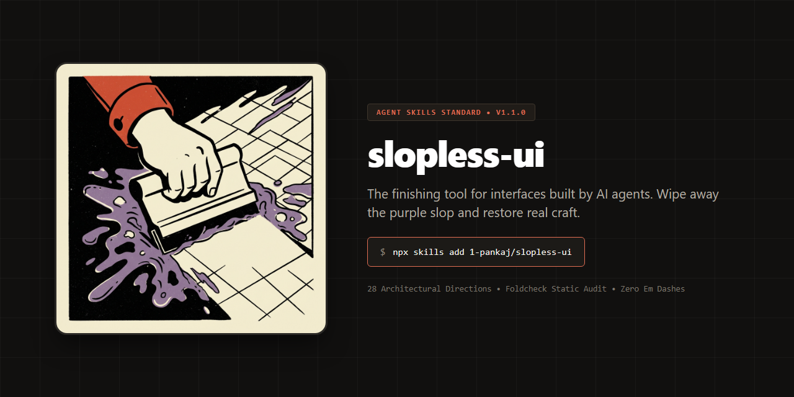
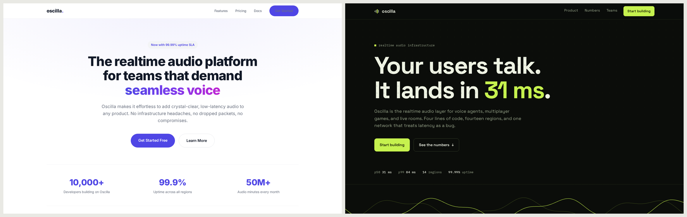
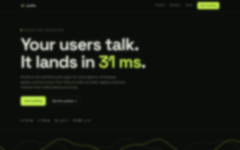
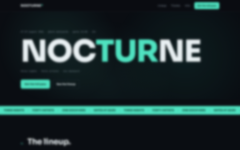

<div align="center">



# slopless-ui

**The finishing tool for interfaces built by AI agents.**

One skill that gives your agent a design direction before it builds, a set of
non-negotiables while it builds, a motion pass with the same discipline, and a
verified finishing check before it dares to say the word "done".

[](https://github.com/1-pankaj/slopless-ui/actions/workflows/ci.yml)
[](CHANGELOG.md)
[](LICENSE)
[](https://agentskills.io)
[](https://github.com/1-pankaj/slopless-ui/stargazers)

<br/>
<br/>



</div>

---

Slop is the machine-made look: the default gradient hero, an icon on every heading, a button on every action, copy full of em dashes and adjectives, and no decision anywhere you could defend in a review. Generated interfaces rarely fail on broken markup anymore. They fail on being interchangeable: competent, polished, impossible to remember. This skill exists so an agent's output is not. It does not add more styling. It adds decisions, a pulse, and discipline, and then it checks the result in a real browser before letting anyone see it.

## Three pairs, one method

Every example is a fictional business built twice: once the way a competent unguided model writes today, once with slopless-ui. The test suite proves the unguided build fails the audit on real patterns and the finished build passes with zero findings.



**[oscilla](examples/oscilla/)**, a realtime audio API in Persuade mode, on the Showroom direction with the Volt palette. The before page is not a caricature, and that is the point: semantic markup, passing contrast, no emoji, no lorem ipsum. It would survive a casual review. It still reads machine-made: Inter as the identity font, an indigo-to-fuchsia gradient headline, three identical cards, centered everything, invented stats, "seamless" and "effortless" in the copy, and not one animated pixel. The after has a direction instead: Space Grotesk and Plex Mono on graphite, a live waveform that follows the cursor, a copyable quickstart, latency bars framed as published measurements, count-ups, a magnetic CTA, and a ticker of client names.

**[outerform](examples/outerform/)**, a product studio in Experience mode, on the Broadside direction with the Signal palette. The after leads with "SMALL STUDIO. LOUD WORK." in Syne, a tilted capability ticker, and a work index whose covers chase the cursor across the page. On touch the preview steps aside for inline covers; under reduced motion everything holds still and stays readable. The studio stats have a pulse of their own: 26 products shipped, 9 people, 12 slides deck maximum, 2 office dogs.

**[nocturne](examples/nocturne/)**, a music festival in Persuade mode, on the Marquee direction with the Nightbus palette. The before is the event template everyone has shipped: purple gradient title, glow blob, frozen countdown, artist cards with an emoji where the photo goes. The after is a poster that breathes: a giant Sora headline, one slow ambient field that pauses when you leave the tab, a diagonal teal ticker, three nights of named rows that fill on hover, and urgency built from facts ("prices rise 1 july. the full pass sold out in 2024 and 2025.").

Every difference, and the rule that fixes each one, is listed per pair in [examples/README.md](examples/README.md).

## The method

The skill walks the agent through five steps. Each step's depth lives in a reference file, loaded only when needed, so the standing cost is one short SKILL.md.

1. **Read the room.** Existing tokens, brand, and components come first. Consistency before taste.
2. **Write the brief.** Four lines before any code: audience, feeling, signature, mode. No brief, no build.
3. **Pick a direction and decide as tokens.** Twenty-eight named style directions cover the categories agents actually build for, executed in the modern register by default. Then the decisions become real CSS values: two typefaces, one accent, spacing and motion tokens. "Clean and modern" is not a decision.
4. **Build with the grain.** The laws real design systems run on (grid, spacing scale, hierarchy, states, keyboard, contrast), the motion budget (answers on every control, one entrance, quiet reveals, one named ambient), buttons as commitments, icons as furniture, copy through the humanizer pass.
5. **Finish before delivery.** Static audit, contrast check, browser screenshots, the squint test, a bounded fix loop, and an honest verification label.

## What it refuses to ship

Blinking, pulsing, or bouncing dots. Cyberpunk, neon, glitch, and synthwave styling. Purple-to-blue gradient heroes and gradient text. Glow with no source. Emoji as icons. An icon on every heading. A button on every action. Em dashes in user-facing text. "Seamless", "revolutionary", "unlock", "elevate". Lorem ipsum and "coming soon". Inter, Roboto, Arial, or the system stack as the identity font. A page that never moves. Every entry comes with the reason and the fix in [references/anti-slop.md](references/anti-slop.md).

When a user genuinely asks for one of these, the skill builds it well and says so once. The list guards unguided output, not expressed preference.

## What is in the box

```
slopless-ui/
├── SKILL.md                  the method, the non-negotiables, the finishing pass
├── references/
│   ├── direction.md          the brief, four modes, the modern register, 28 directions
│   ├── foundations.md        the laws: grid, spacing, hierarchy, states, named UX laws
│   ├── typography.md         the two-voice rule, 25 vetted OFL pairings, the scale
│   ├── color.md              six-role palettes, 20 authored palettes, contrast rules
│   ├── motion.md             the motion budget, entrance and scroll choreography,
│   │                         the signature ambient, tickers, pointer flourishes,
│   │                         springs, canvas rules, reduced motion
│   ├── copy.md               the em dash rule, cadence, the humanizer pass, banned words
│   ├── icons-and-buttons.md  buttons as commitments, icons as furniture
│   ├── anti-slop.md          the full catalogue: pattern, why, fix
│   └── verification.md       the finishing protocol and honesty labels
├── scripts/
│   ├── foldcheck.py          static audit, 27 rules for machine-made patterns (zero deps)
│   ├── contrast.py           WCAG contrast with a suggested passing shade (zero deps)
│   └── finish.mjs            browser pass: screenshots, console, overflow (Playwright)
├── examples/                 three fictional businesses, each built twice
│   ├── oscilla/              realtime audio API: before fails foldcheck, index passes
│   ├── outerform/            product studio: same pair, Experience mode
│   └── nocturne/             music festival: same pair, Persuade mode
├── tests/                    fixtures, a 29-check suite, and a palette ratio checker
├── docs/                     screenshots: each pair, mobile views, squint thumbnails
└── .github/workflows/ci.yml  the 29-check suite on every push and pull request
```

## Install

```bash
npx skills add 1-pankaj/slopless-ui
```

Or by hand:

```bash
git clone https://github.com/1-pankaj/slopless-ui.git
cp -r slopless-ui <skills-directory>
```

| Agent | Skills directory |
|---|---|
| Claude Code | `.claude/skills/` |
| Antigravity | `.agents/skills/` |
| Gemini CLI | `.gemini/skills/` |
| Anything that reads `SKILL.md` | wherever your agent scans |

Global install: add `-g`, or copy into the user-level directory (`~/.claude/skills/` for Claude Code). Reload the tool afterwards; skills are discovered when a session starts.

## Use it

You do not have to invoke anything. The agent loads the skill when a task produces something visible. When you want it deliberately:

> Build a landing page for my developer tool. Use slopless-ui.

> This dashboard feels like template soup. Restyle it with slopless-ui.

> Run the finishing pass on src/ and fix what it finds.

## The finishing gate

The rule is blunt: nothing is presented that was not looked at. `foldcheck.py` catches the mechanical tells first (looping decoration, default gradient heroes, rainbow gradients, glow, emoji icons, icon and button spam, lorem ipsum, hotlinked stock images, sub-12px text, em dashes, and more):

```text
$ python3 scripts/foldcheck.py src/

src/landing.html
  12:9   GRADIENT-HERO  [error]  Purple/indigo/fuchsia hue-to-hue gradient...
  31:41  EM-DASH        [error]  Em dash in text. Use a period, a comma, or parentheses.
  47:32  LOOP-INFINITE  [error]  Infinite CSS animation. Only real states (loading,
                                 progress) and content tickers may loop...

1 file(s) with findings. 3 error(s), 0 warning(s), 0 note(s).
Fail. Fix findings before delivery (see references/anti-slop.md).
```

`contrast.py` grades every color pair and suggests the nearest passing shade. `finish.mjs` screenshots at desktop and phone widths, collects console errors, and fails on horizontal overflow. Every claim ends with an honesty label: verified visually, verified statically, or not verified.

## The examples, verified

All three finished pages are built entirely by the rules. Each one carries its design contract and brief in a source comment, passes `foldcheck` with zero findings, ships a reduced-motion pass that keeps every fact readable, and renders at 1440px and 390px with zero console errors and zero horizontal overflow. Their siblings fail on purpose, and the suite checks that too.

| Pair | Squint test |
|---|---|
| [oscilla](examples/oscilla/) |  |
| [outerform](examples/outerform/) |  |
| [nocturne](examples/nocturne/) |  |

## The palettes and pairings

Twenty authored palettes live in [references/color.md](references/color.md), each with all six roles and contrast ratios computed by the bundled script. None are default framework palettes; all are anchored in materials: paper, peat, harbor water, plowed fields, mulberries, patina, graphite, reef coral, drafting paper, theater brass, banknotes, safelight amber, varsity cream, plaster, map paper, photocopier toner, crayon wax, electric lime on graphite, safety orange on a workshop wall, festival light on wet asphalt. Twenty-five type pairings live in [references/typography.md](references/typography.md), every family verified OFL in the google/fonts repository. Swap the hue, keep the ratios.

The numbers cannot drift: `tests/check_ratios.py` re-computes every ratio documented in color.md from the tables, and CI fails if a doc number stops matching the script.

## Honest scope

- The skill is opinion, written down. It makes good output likely and slop unlikely; it does not replace a human looking at the work.
- `foldcheck.py` is a heuristic linter, not a proof. Its catalogue grows from real observations; [CONTRIBUTING.md](CONTRIBUTING.md) explains how to add a rule.
- Scripts are zero-dependency by design. `finish.mjs` needs Playwright only for the browser pass, and it exits with clear instructions when that is missing instead of pretending to verify.
- CI runs a 29-check suite ([tests/run_tests.sh](tests/run_tests.sh)) covering both Python scripts, both fixtures, all six example pages, the ticker exemption, reduced-motion and reveal checks on every finished page, frontmatter validity, a repo-wide em-dash sweep, and the palette ratio checker. The skill follows its own rules or the tests say so.

## FAQ

**Does it work outside Claude Code?**
Yes. The folder follows the Agent Skills standard, so Antigravity, Gemini CLI, Codex, and anything that reads a `SKILL.md` can load it. Worst case, point your agent's rules file at `SKILL.md` and it works as a plain rules document.

**Only twenty-eight styles? My project is odd.**
The directions are starting points, not costumes: the skill says to change at least two things until the choice fits the product, and the modes (Persuade, Operate, Read, Experience) plus the foundations carry the rest. Odd projects usually need one direction plus one deliberate rule-break, which the skill teaches.

**Will the motion guidance make everything bouncy?**
No. The motion budget spends deliberately: press feedback everywhere, one entrance, quiet reveals, and at most one ambient that must be named in the brief and tied to the product. Dashboards and docs get almost none of it; Experience pages earn the most. Reduced motion ships with every build.

**Will it slow my agent down?**
The opposite is the intent. One short SKILL.md loads when relevant; references load one at a time, on demand; scripts replace expensive "look at it again" loops with cheap deterministic checks.

**Can I use the palettes and pairings in my own design system?**
Yes, they are MIT like everything else. The contrast numbers are real measurements, so keep the ratios if you swap hues.

**Why no em dashes, even in this README?**
Because the rule you do not follow yourself convinces nobody. CI sweeps every text file in this repo for them.

**Why "slopless-ui"?**
It names the failure it fixes, and it is findable: these are the words a person types when they are tired of generated sameness. The shorter form was already taken when the skill was named; the -ui variant was not, and nothing clever needs explaining twice.

## Contributing

Small, sharp changes are welcome. The house rules are in [CONTRIBUTING.md](CONTRIBUTING.md): every new foldcheck rule needs a fixture, every palette number must come from the contrast script, and the repo's own text stays free of em dashes.

## License

[MIT](LICENSE) (c) 2026 Pankaj Israni. Fonts referenced by the skill are OFL licensed and verified in the google/fonts repository; nothing is bundled or redistributed.

## Author

Built by [Pankaj Israni](https://github.com/1-pankaj), who kept failing generated interfaces on the squint test and decided the fix belonged in the agent, not in another round of feedback.

If slopless-ui saved you a revision round, a star helps the next person find it.

<a href="https://star-history.com/#1-pankaj/slopless-ui&Date">
 <picture>
   <source media="(prefers-color-scheme: dark)" srcset="https://api.star-history.com/svg?repos=1-pankaj/slopless-ui&type=Date&theme=dark" />
   <source media="(prefers-color-scheme: light)" srcset="https://api.star-history.com/svg?repos=1-pankaj/slopless-ui&type=Date" />
   
 </picture>
</a>
